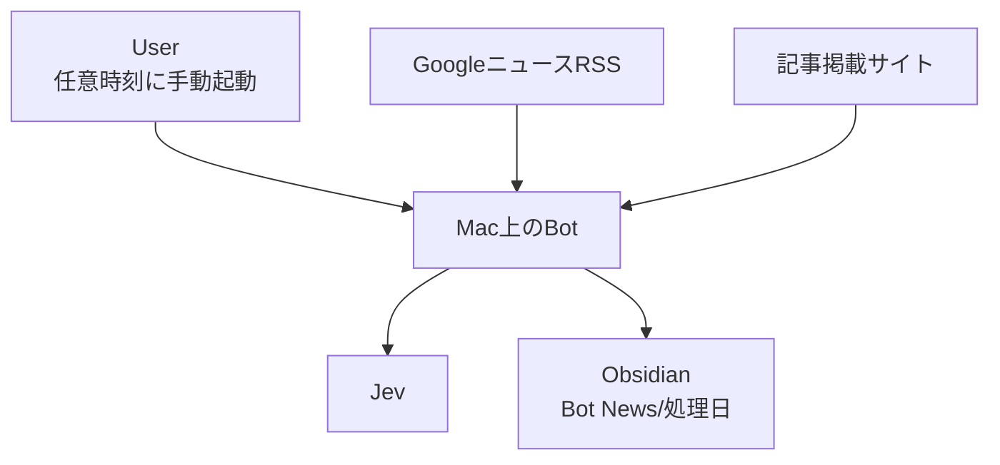
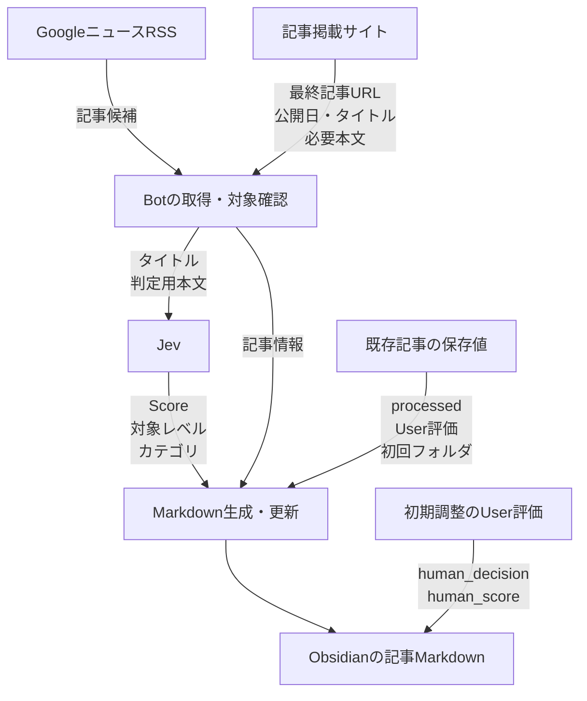

# Architecture Design（アーキテクチャ設計）

Document Info（文書情報）

| Item（項目） | Value（値） |
|---|---|
| Document ID（文書ID） | ARCH-001 |
| Version（バージョン） | 0.1 |
| Status（ステータス） | Draft |
| Created Date（作成日） | 2026-10-06 |
| Last Updated（最終更新日） | 2026-10-23 |
| Owner（管理者） | Takashi Oikawa |
| Related Documents（関連文書） | README.md / 02_REQUIREMENTS_DEFINITION.md / 03_DATA_AND_SECURITY_DESIGN.md / 04_UI_AND_FLOW_DESIGN.md / 06_OPERATION_AND_HANDOFF.md / ../../project-notes/CURRENT.md |

---

## Table of Contents（目次）

1. [Purpose（目的）](#1-purpose目的)
2. [Scope（対象範囲）](#2-scope対象範囲)
3. [Out of Scope（対象外範囲）](#3-out-of-scope対象外範囲)
4. [Assumptions（前提条件）](#4-assumptions前提条件)
5. [Definition Details（定義内容）](#5-definition-details定義内容)
6. [Open Issues（未決事項）](#6-open-issues未決事項)
7. [Handoff to Detail Design（詳細設計への引き継ぎ）](#7-handoff-to-detail-design詳細設計への引き継ぎ)

---

## 1. Purpose（目的）

本文書は、`jev-news-selector` のアーキテクチャの正本である。システム構成、責務分離、外部連携、実行環境を定義する。

読者は、設計担当・実装担当である。

---

## 2. Scope（対象範囲）

- ローカルPython Botの構成と責務分離
- 記事の取得元・記事掲載サイト・Jev・Obsidian Vault との連携
- 実行環境

---

## 3. Out of Scope（対象外範囲）

- サーバー、クラウド常駐、Webアプリとしての構成
- 定期自動起動
- 自動選別の仕組み。自動選別条件は未決であり、初期版に含めない
- CLIの具体的なコマンド・引数。未確認であり、本文書で定めない
- RSSのURL、使用ライブラリ、記事情報の抽出方式（O-05）。本文書で確定しない
- 入口の分野・検索語の具体一覧。[02_REQUIREMENTS_DEFINITION.md](./02_REQUIREMENTS_DEFINITION.md) §5.1.6 で管理し、本文書で補完しない

---

## 4. Assumptions（前提条件）

- 実行環境は MacBook Air M4 / macOS である
- Botは、Userが任意の時刻に手動起動するローカルPythonプログラムである。CLIの具体的なコマンド・引数は未確認
- 保存先はUserのMac上の Obsidian Vault である（絶対パスは O-06。[03_DATA_AND_SECURITY_DESIGN.md](./03_DATA_AND_SECURITY_DESIGN.md)）

---

## 5. Definition Details（定義内容）

### 5.1 System Architecture Diagram（システム構成図）

処理の分岐は [04_UI_AND_FLOW_DESIGN.md](./04_UI_AND_FLOW_DESIGN.md#entry-diagram) と [Article Diagram](./04_UI_AND_FLOW_DESIGN.md#article-diagram) を正とする。本節は構成と、矢印が渡す情報を示す。RSSのURL、抽出ライブラリ、保存量、Jevの呼出方式、CLIの具体的なコマンド・引数、HTTP呼出し回数は図で定めない。

#### System Diagram

Mac上のBotと、外部サービス、保存先の関係を示す。

#### Data Flow Diagram

矢印は渡す情報を示す。User評価は初期調整の別入力であり、Jevの結果を上書きしない。既存記事の保持項目は、再処理の更新時に使う。

- Botは MacBook Air M4 上のローカルPythonである。CLIの具体的なコマンド・引数は未確認である
- GoogleニュースRSSは採用済みであり、検証は未完了である。URLと使用ライブラリは未確認である
- 記事掲載サイトからの抽出方式は O-05 である。状態は OPEN であり、具体値は原記録未復元である
- Jevの呼出方式は未決である。Scoreは返された値のまま後続へ渡す
- User評価の矢印は、保存済みMarkdownへの別入力である。入力UIは指定しない

### 5.2 Technology Stack and Rationale（技術スタック・採用理由）

| Type（種別） | Technology（採用技術） | Version（バージョン） | Rationale（採用理由） |
|---|---|---|---|
| Language（言語） | Python | 指定なし | Userにより確定済み |
| Framework（フレームワーク） | 未決 | 未決 | 本文書で確定しない |
| Database（DB） | 本設計に含めない | ― | 保存先は Obsidian Vault 内の Markdown である。ただし、Markdown保存であることだけを根拠にDBの採否を確定しない（[CURRENT.md](../../project-notes/CURRENT.md) Blockers） |
| Infrastructure（インフラ） | MacBook Air M4 / macOS ローカル実行 | ― | Userにより確定済み |
| Other（その他） | Obsidian Vault（YAML frontmatter付きMarkdownの保存先）、Jev（判定） | ― | Userにより確定済み |

本文書では以下を確定しない。AI判断で確定しない。

- CLIの具体的なコマンド・引数
- RSSのURLと使用ライブラリ（RSS方式の採用と検証は §5.3。URLとライブラリは未確認）
- 入口の分野・検索語の具体一覧（[02_REQUIREMENTS_DEFINITION.md](./02_REQUIREMENTS_DEFINITION.md) §5.1.6。原記録未復元）
- Pythonライブラリ（記事抽出用を含む。O-05。状態は OPEN。具体値は原記録未復元）
- Framework
- クラス分割
- Jev SDK / API の具体方式
- HTML抽出ライブラリ（O-05）
- URL検索方式・最終記事URLの正規化方式（O-04）
- データベースの採否

### 5.3 Module Structure and Layer Design（モジュール構成・レイヤー設計）

責務を次のとおり分離する。本節は責務の分担を定めるものであり、クラス・ファイル・パッケージの分割は定めない。

| Responsibility（責務） | Details（内容） |
|---|---|
| Startup（起動） | Userによる任意時刻の手動起動を受けて処理を開始する。URL入力を受け付ける責務を持たない。CLIの具体的なコマンド・引数は定めない |
| Article Retrieval（記事取得・記事情報取得） | GoogleニュースのRSSで入口の処理対象を取得し、最終記事URLを取得する。記事タイトル・記事公開日・必要本文を取得する。RSS方式は採用済みであり、検証は未完了である。URLと使用ライブラリは未確認。入口の分野・検索語と検証用件数上限は [02_REQUIREMENTS_DEFINITION.md](./02_REQUIREMENTS_DEFINITION.md) §5.1.6。記事情報の抽出方式は O-05 |
| Date Judgment（公開日判定） | 公開日を JST の日付として決定し（タイムゾーン付き日時は Asia/Tokyo へ変換、日付だけなら明示された日付）、Bot実行日または前日であるかを判定する。公開日を補完しない。登録済みの記事でも毎回判定する |
| Jev Judgment（Jev判定） | Jevから指導有用度Score・対象レベル・記事カテゴリ（単一値）を得る。Scoreは返された値のまま後続へ渡し、丸めない。再処理時も同じ責務で再判定する。文章生成をさせない |
| Markdown Generation（Markdown生成） | YAML frontmatter と本文（[03_DATA_AND_SECURITY_DESIGN.md](./03_DATA_AND_SECURITY_DESIGN.md) §5.2）を組み立てる。再処理時は更新規則に従い、`published` と本文の公開日表示を最新の取得値へ更新し、`processed` とUser評価を保持する |
| Obsidian Storage（Obsidian保存） | 最終記事URLで登録済み記事を特定する（方式は O-04）。未登録なら処理日フォルダの決定・同一タイトル別URLの衝突回避・新規作成を行い、登録済みなら初回処理日フォルダの既存Markdownを更新する |

### 5.4 External Integration and API Design（外部システム連携・API設計方針）

| Integration Target / API Name（連携先 / API名） | Method（連携方式） | Purpose / Overview（用途・概要） |
|---|---|---|
| GoogleニュースRSS | RSS（採用し、検証する。URL・使用ライブラリは未確認） | 入口の処理対象の取得。分野・検索語と検証用件数上限は [02_REQUIREMENTS_DEFINITION.md](./02_REQUIREMENTS_DEFINITION.md) §5.1.6 |
| 記事掲載サイト | 未決（O-05） | 最終記事URLへの到達、記事タイトル・記事公開日・必要本文の取得 |
| Jev | 未決（実装段階で決定） | 指導有用度Score・対象レベル・記事カテゴリの判定。認証情報の扱いは [03_DATA_AND_SECURITY_DESIGN.md](./03_DATA_AND_SECURITY_DESIGN.md) §5.4 |
| Obsidian Vault | ローカルファイルとしての Markdown 作成・更新 | 判定結果の保存 |

### 5.5 Scalability and Fault Tolerance（スケーラビリティ方針・障害対策）

| Aspect（観点） | Design Details（設計内容） |
|---|---|
| Scaling Policy（スケーリング方針） | 本文書では対象外。理由: 単一Userのローカル実行であるため |
| Redundancy（冗長化） | 本文書では対象外。理由: 単一Userのローカル実行であるため |
| Failover（フェイルオーバー） | 本文書では対象外。理由: 単一Userのローカル実行であるため |
| Other Fault Tolerance（その他耐障害設計） | 本文書では定めない。取得・Jev判定・保存に失敗した場合の扱いは未確認である（[CURRENT.md](../../project-notes/CURRENT.md) Blockers）。再試行・ログ・監視・バックアップを AI判断で追加しない |

### 5.6 Infrastructure and Environment（インフラ・環境構成）

| Environment（環境） | Configuration / Resources（構成・リソース概要） |
|---|---|
| Development（開発） | MacBook Air M4 / macOS。Repository の作業場所は `~/Dev/jev-news-selector/` |
| Staging（ステージング） | なし。テスト専用環境は `~/local_test_env/jev-news-selector/` を使用する |
| Production（本番） | 本番サーバーはない。Userの MacBook Air M4 上でのローカル実行を運用環境とする |

---

## 6. Open Issues（未決事項）

| ID | Open Issue（未決事項） | Owner（担当者） | Due Date（期限） | Status（ステータス） |
|---|---|---|---|---|
| O-04 | URL重複検索方式。一意キーが最終記事URLであることは確定しており、既存Markdownをどの方法で検索するか、および最終記事URLの具体的正規化方式（追跡用Query Parameter等の扱い）が未決 | Takashi Oikawa | 未定 | OPEN |
| O-05 | 記事情報抽出方式。記事タイトル取得方式・記事公開日取得方式・記事本文取得方式、および使用するPythonライブラリ。状態は OPEN。Userから暫定採用を指摘する発言がある。具体値は原記録未復元である。再選定が必要とは断定しない | Takashi Oikawa | 未定 | OPEN |

### ニュース選別ロジックの概要設計案（2026-10-23・未承認）

Userの指示に基づき、検討途中の案を本節に記録する。Jevの現行仕様との照合前であり、有効な処理要件や実装指示ではない。既存のF/O/R分類、O-01〜O-06、FR-012の全件保存方針を変更しない。自動選別の導入は [06_OPERATION_AND_HANDOFF.md](./06_OPERATION_AND_HANDOFF.md) §5.6 の手順に従う。

#### 初期データの位置付け

- Google保存済み「すぐ確認」の251件と初期77語句は、関心対象と選別ロジックを考えるとっかかりのデータである。Userはデータの厳密化より、本体ロジックの検討を優先する方針を示した。
- 77語句を固定条件として251件を振り分けることが目的ではない。251件を読み、77語句に追加・補強できる語句や判断基準を検討する。
- タイトル・登録URLを基に、新規候補29項目・既存語句の補強9項目・要確認2項目を整理した。追加採用は未確定であり、複数語句を含む項目もあるため、77に項目数を足して確定語句数としない。
- 既存77語句の画面上の判定は採用58・除外1・保留5・未確認13だった。保存事実や出現頻度だけで現在の関心・重要度・採用の正解を決めない。記事本文とタイトルの事実性は未検証である。
- 以前の単純照合結果「採用205・除外3・保留43」は、今回の追加検討の結論や正解データとして使用しない。

#### 3段階のFilter案

| 段階 | 役割 | 検討する処理 |
|---|---|---|
| Filter1：基本整理 | 判定対象の情報を整える | URL・記事の重複確認、対象期間の確認、情報不足の識別 |
| Filter2：関心判定 | 関心との関連を評価する | 記事の主題、項目ごとの重み、項目間の関係性、減点・除外条件を評価し、採用候補・保留・除外を分ける |
| Filter3：優先度判定 | 読む順番を決める | Userへの影響、緊急性、新規性、具体的な手順・検証・事例の有無を評価する |

各段階を一律の足切りにはしない。関心との一致と読む緊急性は別に評価する。Filterという呼称・配置も仮案であり、入口の50件上限や公開日条件を変更しない。同じタイトルでも最終記事URLが異なる記事をまとめて保存しない案へ変更するものではない。情報不足の保留案は、現行の「公開日不明は対象外」を上書きしない。

#### 重みと関係性の評価案

単純な「3語句以上一致」での採用ではなく、異なる観点の重みと意味のある組み合わせを評価する。

| 評価要素 | 内容の例 |
|---|---|
| 対象技術・製品・言語 | AI、Java、Python、利用中製品 |
| 用途 | 教育、設計、開発、業務改善 |
| 課題 | 品質、安全性、理解不足、効率 |
| 記事の内容 | 手順、検証、活用事例、重要な変更 |

基本形は **関心点＝項目ごとの加点＋関係性による加点−減点** とする案である。

- 「Java＋教育」「AI＋設計」など、異なる観点が記事の主題として関係する場合に組み合わせを評価する。単に語句が共存するだけで成立としない。
- 同義語・表記揺れや「プログラミング言語＋Java」のような親子関係を二重加点しない。企業名とモデル名などの関係語も、完全な同義語とは区別する。
- 主題と関係しない語句、媒体名だけの一致を加点根拠にしない。広い語句を重ねるだけで点数が膨張しないようにする。
- 説明用の仮例は「Java 3点＋教育4点＋組み合わせ3点＝10点」。数値・上限・基準値は未確定である。
- この関心点は既存の `jev_score`（指導有用度0〜4）とは別の検討概念であり、置換・加算・換算を確定しない。`jev_score` の保存値を変更しない。

#### 例外・説明・調整の案

- 利用中製品の重大な脆弱性・障害・サポート終了は、通常の関心点とは別に優先表示する例外を検討する。
- 必ず拾う対象・外す対象の手動指定を検討する。採用条件と除外条件が競合する場合や、判断材料が不足する場合は保留にする案とする。例外・手動指定・除外・通常点数の適用順は未確定である。
- 判定結果、該当項目、組み合わせ、点数内訳、適用理由、表示優先度をUserが確認できるようにする案である。専用GUIや保存キーの追加は確定しない。Jevによる説明文生成が可能であるとも断定しない。
- ルールの有効／無効・条件・重みを調整し、Userの修正履歴を残す案である。既存のJev評価とUser評価は上書きしない。候補の「保留」は既存 `human_decision` の値追加を意味しない。
- 修正結果からの自動学習は未決定であり、モデル再学習の採用ではない。

#### 次に確かめる事項

1. Jev自体の入力・出力・判定方法・制約を一次資料で確認し、現行設計と照合する。重み計算・関係性評価・優先順位付け・説明表示をJevとアプリのどちらが担うか決める。
2. タイトル・概要・必要本文の入力範囲、項目分類、同義語・親子関係、重み・上限・減点、組み合わせ、採否の基準値、例外の優先順位を具体化する。
3. 動作確認後の品質改善段階で、Userが読みたい記事の取りこぼしと不要記事の混入を確認する。初期の251件はテスト用であり、初期動作確認に対象外例の追加を必須としない。これは既存のJev安定判定や自動選別導入の手順を省略するものではない。

本案の採用範囲、分類管理、他設計文書への正式反映は後続の判断とする。新規F/O/R-IDは採番しない。

### Python・Jev APIを用いるプログラム概要設計案（2026-10-23）

Userの「PythonをベースにJavAPIを使用したPRGの概要設計を開始」という指示は、文脈上Jev APIを指すものとして扱う。実装は行わず、以下を未承認の設計案として記録する。既存の初期版要件を維持し、将来の選別計算は別段階で検証する。

#### 開発・検証の段階（2026-10-23 User方針）

| 段階 | 実施内容 | 次段階へ進む条件 |
|---|---|---|
| 1：最小機能のCLIテスト | コマンドラインからPythonを手動実行し、記事情報をJev APIへ渡して結果を確認する。まず基本の指導有用度・対象レベル・カテゴリを確認し、重み・関係性の試行を順次加える | 入力、API呼出し、回答の型・値域、Python集計を実データで確認できること |
| 2：一連の処理の確認 | RSS取得・対象日確認・Jev判定・Markdown保存／更新をCLIで通して確認する。全件保存とUser評価の保持も確認する | Userが必要な動作を確認すること。確認結果を記録する |
| 3：自動化等の追加 | 動作確認済みの手動処理を基に、自動実行などの機能を設計・実装する | 起動方式・実行条件・失敗時の扱いを具体化する |

初期段階に自動実行・スケジューラー・専用GUIを追加しない。CLIのコマンド名・引数、テスト入力の受け渡し形式は未確定。現時点は概要設計であり、テストプログラムは未実装・API実呼出しは未実施である。

ここでいう自動化は実行の自動化等を指す。記事を点数で自動除外する選別の導入とは別であり、全件保存を変更する場合は06 §5.6の手順に従う。

#### 初期検証の方針とルールのパーツ分割（2026-10-23 User確認）

初期段階では、選別品質よりも、定めたロジックどおりに動作することを優先する。品質は動作確認後に徐々に改善する。品質評価を初期の動作確認の完了条件に含めない。

ルールは独立したパーツに分割し、単独で動作を確認した後に組み合わせて検証する。次表は責務分割案であり、実装のクラス・ファイル構成や具体的な計算値を確定するものではない。

| パーツ | 責務 | 動作確認の例 |
|---|---|---|
| 語句・項目判定 | 入力を関心項目に対応付ける | 一致・不一致・表記揺れが定義どおりに処理される |
| 重み計算 | 項目に設定した基本点を計算する | 同じ入力と設定なら同じ内訳・合計になる |
| 関係性 | 項目の組み合わせと親子・同義関係を扱う | 成立時の加点、不成立時の非加点、二重加点防止 |
| 除外条件 | 定義された除外条件を評価する | 条件一致・不一致で所定の結果になる |
| 例外条件 | 優先表示等の例外を評価する | 通常条件との競合が定義した適用順になる |
| 優先度 | 判定結果から表示順を決める | 所定の順位と、同点時に定義した扱いになる |

組み合わせでは、実行順・入力と出力・有効／無効・競合時の適用順を明示し、途中結果を確認できる構成とする案である。具体的な適用順・基準値・同点処理は後続で定義し、テスト時に期待結果を置く。

現在の251件はテスト用データと割り切る。厳密な正解データ、品質評価用の代表標本、重みの正しさの根拠として扱わない。初期検証のために不要記事の追加収集やデータの厳密化を必須にはしない。

検証を次のように分ける。

1. **固定回答によるロジック確認**：Jevから返る想定の回答を固定入力として与え、各パーツと組み合わせの計算・分岐が期待結果と一致するか確認する。
2. **実APIによる接続確認**：Jev APIの実際の回答を使い、入力→API呼出し→回答確認→パーツの組み合わせ→結果表示の流れを確認する。Jevの回答が固定入力と同じになることは要求しない。
3. **段階的な品質改善**：動作確認後に、質問・重み・関係性・基準値を調整する。初期データの整備を先に完成させる前提にはしない。

固定回答での検証は、実APIとの接続確認の代わりにはならない。テスト用の入力経路は、本番でUserに記事URLの手入力を要求する仕様へ転用しない。

#### APIの確認事項と設計判断

2026-10-23にTypeSafeの公式資料を確認した。下表の「公式仕様」と、本プログラムへの適用案は区別する。

| 区分 | 確認・判断内容 | 出典 |
|---|---|---|
| 公式仕様 | `POST https://api.typesafe.ai/v1/systemone`。認証はBearer token。入力は `model`・`state`・`questions`、結果は質問名に対応した `answers` とモデル・使用量を含む | [API reference](https://docs.typesafe.ai/api) |
| 公式仕様 | Choiceは候補から1つ、Scoreは段階定義に基づく値、Noulは肯定の確率を返す。複数質問は同じstateに対して独立に評価される | [Introduction](https://docs.typesafe.ai/introduction)、[Primitives](https://docs.typesafe.ai/primitives) |
| 公式仕様 | 独立した観点を質問に分解し、コードで結果を組み合わせる使い方が示されている | [Introduction](https://docs.typesafe.ai/introduction) |
| 公式仕様 | Python SDKに同期・非同期クライアントがあり、`client.system_one(state, questions)` で判定を要求できる | [Python SDK](https://docs.typesafe.ai/sdk/python/usage/basic) |
| 設計案 | Jevは意味に関する個別判断、Pythonは重み計算・関係性の合成・閾値判定・順序制御・説明の組立てを担当する | 本節の提案 |

公式資料に書かれた性能・確率は本Botの品質保証ではない。SDK版、モデル識別子、質問数・入力長の上限、タイムアウト・再試行・料金は実装前に再確認する。既存の「Jevの具体方式は未決」は本案だけでは確定へ変更しない。

#### 判断特化型AIの比較候補・利用手順・料金（2026-10-23確認）

以下は調査記録と設計案であり、Jevからの採用変更や初期版への比較機能追加を決定するものではない。実API接続・モデル間の比較試験は未実施。

| モデル・提供元 | API利用開始の手順 | 入力100万トークン当たりの公表料金（USD） | 公式資料 |
|---|---|---|---|
| Jev 1.14／1.13・TypeSafe | TypeSafe Consoleへ登録・ログイン→APIキー取得→Python用typesafe-sdk等から呼出し | $0.042、出力無料 | [利用手順](https://docs.typesafe.ai/introduction/quickstart)、[モデル・料金](https://docs.typesafe.ai/models) |
| Microsoft-Decision-1・Microsoft | 支払い方法付きAzure契約→Foundryプロジェクト作成→モデル配置→接続先・配置名・認証情報取得→API呼出し | $0.042、出力無料 | [利用手順](https://learn.microsoft.com/en-us/azure/foundry/foundry-models/how-to/use-foundry-models-microsoft-decision)、[料金公表](https://commandline.microsoft.com/microsoft-decision-1-model-foundry/) |
| Clef・Cloudflare | Cloudflare登録→Workers AIのUse REST API→APIトークン・Account ID取得→ClefのAPI呼出し | $0.240、出力無料 | [登録・認証](https://developers.cloudflare.com/workers-ai/get-started/rest-api/)、[Clef](https://developers.cloudflare.com/workers-ai/models/clef/)、[料金](https://developers.cloudflare.com/workers-ai/platform/pricing/) |
| Clef-flash・Cloudflare | 上記Cloudflareの手順で小型版モデルを指定 | $0.038、出力無料 | [料金](https://developers.cloudflare.com/workers-ai/platform/pricing/) |

トークンはAIが文章を処理する分割単位であり、文字数とは異なる。記事と質問を合わせて1記事5,000入力トークン、1,000記事・各1回の処理を仮定すると、入力合計500万トークンで、JevとMicrosoft-Decision-1は各$0.21、Clefは$1.20、Clef-flashは$0.19となる。無料枠適用前のモデル処理料金の概算であり、税・為替・前払い条件・周辺サービス費用を含まない。実際の使用量や再呼出し回数で変わる。

Cloudflare Workers AIには1日10,000 Neuronsの無料枠がある。Neuronsは同社独自の処理量単位で、モデルごとにトークンからの換算が異なる。無料枠超過には有料プランが必要。料金・利用条件は利用開始時に公式資料で再確認する。

#### JevとMicrosoft-Decision-1のAPI共用条件（2026-10-23確認）

User提示の「APIキーと接続先を変えれば兼用できる」という情報について、両社の公式API仕様を照合した。基本の送受信構成は共通するが、直接接続ではモデル指定と認証ヘッダーの切り替えも必要である。

| 項目 | Jev直接利用 | Microsoft Foundry |
|---|---|---|
| 接続先 | `https://api.typesafe.ai/v1/systemone` | `<Foundryリソース接続先>/providers/microsoft/v1/systemone` |
| APIキー認証 | `Authorization: Bearer <APIキー>` | `api-key: <APIキー>`。Entra ID認証も選択可能 |
| `model` | Jevのモデル名・識別子 | Azureで設定した配置名 |
| 基本入力 | `model`・`state`・`questions` | 同じ基本構成 |
| 基本質問形式 | `noul`・`choice`・`score` | 同じ3形式 |
| 基本出力 | 質問名に対応した`answers`、`model`、`usage` | 同じ基本構成 |

出典：[TypeSafe API](https://docs.typesafe.ai/api/system-one)、[Microsoft公式利用手順](https://learn.microsoft.com/en-us/azure/foundry/foundry-models/how-to/use-foundry-models-microsoft-decision)。

**設計案**：接続先・認証情報・認証ヘッダー・モデル指定を設定で切り替え、記事・質問・判定基準とPython側の集計ロジックを共用する構成を検討できる。これは仕様照合に基づく判断であり、実接続による互換性確認済みではない。

TypeSafe専用SDKが無変更でAzureへ接続できること、全拡張機能・制限・エラー形式・結果項目が一致すること、同じ判定結果や品質が得られることは保証しない。採用する接続方式で、使用する質問形式と結果の取り出し方を実接続確認してから共用範囲を確定する。SDK・接続方式の未決状態は維持する。

#### Python側の責務分割案

以下は論理的な機能分割であり、ファイル名やクラス名の確定ではない。

| 機能 | 入力 | 処理・出力 |
|---|---|---|
| 実行制御 | 手動起動、設定 | 取得→対象確認→判定→保存の順序を管理する |
| 記事取得 | 分野・検索語、RSS | 既存の全検索語合計50件の検証上限に従って候補を得る。最終記事URL・公開日・タイトル・必要本文を取得する |
| Filter1：対象確認 | 記事情報 | JSTの実行日・前日条件を確認し、最終記事URLで新規／登録済みを識別する。重複を理由に登録済み記事の再処理を省略しない |
| 質問構築 | 記事、関心項目、質問定義 | 記事のタイトル・必要本文をstateにまとめ、単一の観点を問う質問を構築する |
| Jev接続 | state、questions、model | APIを呼び、構造化された回答を受け取る。キーの実値は記録しない |
| 回答確認 | API回答 | 必須質問の欠落、型、値域、Choice候補を確認する。不正・欠落回答を0点や除外へ置き換えない |
| Filter2：関心集計 | 項目判断、重み、関係性ルール | 二重加点を抑え、重み・組み合わせ・減点を計算する。検証用の候補判定を得る |
| Filter3：優先度集計 | 関心判定、影響・緊急性等の判断 | 関心点と別に優先度を計算する。優先表示例外・競合条件を扱う |
| 説明組立て | 適用ルールと計算内訳 | 定型文で該当項目・関係性・点数・例外を表示する。Jevの内部推論の説明と称さない |
| 保存・更新 | 記事、既存Jev判定、既存User評価 | 現行のMarkdownと更新規則に従う。将来の関心点・保留・ルール履歴の保存方法は別途決める |

#### Jevへの質問案

初期版で要求済みの3判断と、将来の選別用の追加判断を区別する。

| 区分 | 質問の例 | 型の案 | 扱い |
|---|---|---|---|
| 初期版 | 対面指導への有用度 | Score | 現行0〜4の段階定義を使用し、小数を丸めず `jev_score` へ保存 |
| 初期版 | 対象レベル | Choice | `beginner` / `intermediate` / `other` |
| 初期版 | 記事カテゴリ | Choice | 現行10候補から単一値。O-01の未確定状態を維持 |
| 将来案 | Javaが記事の主題として扱われているか | Noul | 語句の登場だけでは肯定としない定義にする |
| 将来案 | 教育・授業への利用が主題か | Noul | 用途に対する独立した判断 |
| 将来案 | Javaと教育が同じ話題として結び付いているか | Noul | 個別項目の肯定だけで関係性を推定せず、必要な組み合わせを直接問う |
| 将来案 | 具体的な手順・検証があるか | Noul | 取得した本文の範囲で判断する |
| 将来案 | 対応の緊急性 | Score | 段階定義は未決。指導有用度とは別の尺度 |

Choiceは単一選択のため、複数の関心項目を一つのChoiceへ押し込まない。必要な項目ごとの質問を使う。質問同士の回答は共有されないため、後続質問が先行回答を参照する前提にしない。

#### 計算と関係性の案

1. 語句照合は質問候補の手掛かりとし、語句がないことだけで関連なしと確定しない。
2. Jevの項目ごとの回答から、Pythonがルール適用の可否を決める。Noulの値は肯定の確率であり、関心の強さの点数ではない。
3. 同義語・親子関係をグループ管理し、同じ意味の基本点を重複計上しない。
4. 組み合わせは個別項目に加え、意味上の関係が成立する場合に加点する。例えばJava・教育がそれぞれ肯定でも、別々の話題なら組み合わせ点を付けない。
5. 重み・加点・減点はPythonで計算し、関心点と指導有用度Scoreを混ぜない。確率をそのまま掛け合わせて組み合わせの確率としない。
6. 回答が曖昧な場合の保留幅、重みの上限、組み合わせの多重加点防止、採否基準値はテスト用の仮設定で動作を確認し、品質改善段階で調整する。

77語句すべてを毎回API質問にする構成は未採用。質問数、取りこぼし、入力量、API費用を比較して質問のまとめ方・分割を決める。

#### データと検証の案

記事情報、質問定義、関心ルール、Jev回答、Pythonの集計結果を別の論理データとして扱う。検証の再現に必要なモデル名・質問定義版・ルール版を対応付ける案とする。JSON／YAML等の具体形式、認証情報の保存方式、履歴の保存場所は未確定。

既存の処理では対象記事を全件保存する。将来案はまず保存対象を減らさない試験として比較し、承認前に採否結果を自動破棄へ接続しない。API失敗・回答不正時の停止／継続・再試行・記録方法は既存の未確認事項として残す。

検証では、既存3判断の値域と保存値、回答欠落・型不正、同義語の二重加点、別話題の語句共存、除外と例外の競合について、定義したロジックどおりの動作を確認する。251件はテスト用とし、過去記事も含まれるため、関心判定単体の試験と、実行日・前日の入口条件を含む結合試験を分ける。初期の完了条件に選別品質を含めない。試験結果はまだない。

#### Implementation-Stage Items（実装段階で決定する事項）

| Item（項目） | Related Section（関連箇所） |
|---|---|
| Jevへ渡す本文量 | §5.3 Jev Judgment |
| Jev SDK / API の具体方式 | §5.4 |

RSSのURL・使用ライブラリ、CLIの具体的なコマンド・引数、処理失敗時の扱い、データベースの採否は、O-04・O-05 を含む既存 O-ID に該当しない ID未登録の未確認事項であり、[CURRENT.md](../../project-notes/CURRENT.md) の Blockers に記録する。入口の分野・検索語は暫定採用済みであり、具体一覧は [02_REQUIREMENTS_DEFINITION.md](./02_REQUIREMENTS_DEFINITION.md) §5.1.6 に従い補完しない。

---

## 7. Handoff to Detail Design（詳細設計への引き継ぎ）

- 責務分離は §5.3 に従う。クラス分割・ライブラリ・Framework は実装担当が独自に確定せず、設計担当・Userの承認を得る
- 起動は任意時刻の手動起動である。CLIの具体的なコマンド・引数、RSSのURL、使用ライブラリを AI判断で採用しない。ニュース取得は GoogleニュースのRSS方式を採用し、検証する。API・Crawler を追加の確定方式として採用しない。定期自動起動を追加しない
- 記事情報の抽出方式は O-05 のままとする。具体値を補完しない。再選定が必要とは断定しない
- 一意キーは最終記事URLである。記事取得で得た別のURLで重複判定しない
- データベース、サーバー・クラウド構成、自動選別の仕組みを追加しない
